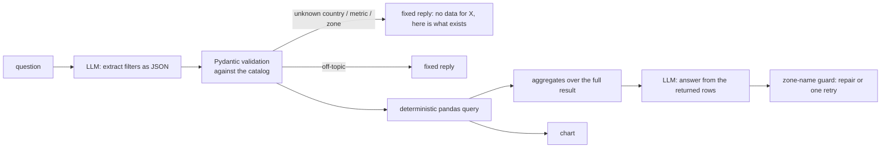

# Delivery Ops Intelligence

[](https://github.com/CamiloC0rtes/delivery-ops-intelligence/actions/workflows/ci.yml)

Ask questions about weekly delivery-operations metrics in plain Spanish — *"¿qué 5 zonas cayeron más en órdenes?"*, *"compara Perfect Orders entre zonas Wealthy y Non Wealthy"* — and get an answer built only from the rows that were actually queried, plus a chart. An insight engine flags anomalies, sustained declines, laggards and opportunities on its own.

**Stack:** FastAPI · OpenAI · pandas · Pydantic · Chart.js · GitHub Actions

> The repo ships with a **synthetic dataset** (108 zones, 6 countries, 9 weeks, 10 metrics) with the same structure as the original. Every zone name and number is invented; a few patterns are planted on purpose so there is something real to find.

---

## How a question is answered



The LLM never computes numbers and never writes code. It only (1) turns the question into filters and (2) explains the rows pandas returned.

- **Validation layer (`entities.py`)** — whatever the model returns is checked against `catalog.py`: an unknown country, metric, city or zone gets an explicit *"no tengo datos de X"* listing what exists, instead of being dropped (which used to answer about everything), `top_n` is coerced and clamped (`"five"` → 5, `999` → 50), enums fall back to safe defaults, and malformed JSON degrades to a summary instead of an error.
- **Fixed filter vocabulary** — semantic concepts like *"deterioro sostenido"* map to conditions from a fixed table; nothing the model writes is executed.
- **Follow-ups** — *"¿y en Argentina?"* keeps the previous metric and ranking and swaps only the country; the extractor sees the filters in force, not just earlier questions.
- **Numbers the LLM can't get wrong** — counts, averages, min/max are computed by pandas over the full result and passed as a summary; the table it sees may be a sample, and it is told so. Rankings are always sorted, by level ("más pedidos") or by week-over-week change ("mayor caída").
- **Zone-name guard** — if the answer names a real zone that is not in the result (the model liked shortening "Los Eucaliptos Alto" into "Los Eucaliptos", another zone in another city), the name is repaired, or the answer is regenerated once.
- **Input limits** — empty or >500-character questions are rejected before any LLM call; off-topic questions get a fixed reply.

## Evaluation

`tests/eval/golden.jsonl` holds 22 questions: 12 regular ones (rankings, filters, comparisons, multi-metric, correlations, follow-ups) and 10 adversarial ones (a country, metric or zone that doesn't exist, typos, English, a prompt-injection attempt, an off-topic question, counts and averages, a three-turn follow-up chain). For each one the eval checks:

| Check | Question it answers |
|---|---|
| **Extraction** | Did the LLM produce the expected filters (metric, country, top_n, direction…)? |
| **Grounding** | Does the answer mention the top zones that pandas returns for those filters? |
| **Fabrication** | Does the answer name any real zone that is *not* in the queried result? |

Ground truth comes from the same deterministic engine, so a wrong extraction shows up as both an extraction miss and a grounding miss.

```bash
OPENAI_API_KEY=... python -m tests.eval.run_eval      # writes eval_report.md
```

**Results (gpt-4o-mini):**

| Run | Pass | What it caught → fix |
|---|---|---|
| 1 | 8/12 | Questions with many filters lost all of them (extraction capped at 150 tokens) · a country-only follow-up got a city it never mentioned · comparisons routed as multi-metric → 400 tokens + JSON mode, follow-ups apply only the keys the model sent, explicit prompt rules |
| 2 | 9/12 | The answer shortened "Los Eucaliptos Alto" to "Los Eucaliptos", **a different real zone** · `top_n` omitted for "las 3 zonas" → exact-name rule, deterministic `top_n` backup |
| 3 | 12/12 | |
| — | — | **Adversarial pass** (by hand against the live app, then added to the golden set): totals and averages computed by the LLM from a 20-row sample ("9 zones", real: 108) · unsorted rankings · unknown countries/metrics silently dropped, answering about *everything* · follow-ups reverting earlier changes · `+27,233%` changes on near-zero bases · 500s on NaN and regex characters |
| 4 | 12/22 | The new `out_of_scope` intent was over-applied ("NPS de Bogotá" got a brush-off) · follow-ups switched ranking mode · eval ground truth still ranked "mayor ganancia" by % change, a bug shared with the old system |
| 5 | 17/22 | The zone-name shortening survived the prompt rule *and* a corrective retry → deterministic repair · re-extraction when `out_of_scope` is overridden |
| 6 | 21/22 | The extractor sometimes drops filters it can't map ("NPS", "Venezuela") → deterministic backstops for unsupported KPIs, cities and countries in the text |
| 7–9 | **22/22 ×3** | p95 4.2–4.8 s · median 3.2–3.4 s |

The lesson that repeats: every prompt-only fix held for some runs and not others; the stable fixes were deterministic (validation, backstops, name repair, aggregates computed in pandas).

LLM output is not deterministic, so a single run is a sample: after a prompt change, run it several times.

It also runs from **Actions → Accuracy eval** (needs an `OPENAI_API_KEY` repo secret).

## Insight engine

Runs at start-up over every zone × metric and ranks findings by severity:

- **Anomalies** — week-over-week swings beyond ±10 %
- **Sustained trends** — 3+ consecutive weeks down or up. Severity scales with the size of the move, so a 0.1 % wobble is not reported as an incident
- **Benchmarks** — zones more than 1.5 σ below their city
- **Opportunities** and **correlations** between metrics

## Run it

```bash
pip install -r requirements.txt
cp .env.example .env          # add OPENAI_API_KEY to enable the chat (optional)
python app.py                 # http://localhost:8000
```

Without a key the app still starts: dashboards, insights and zone charts work; only the chat is disabled.

```bash
python scripts/generate_data.py --seed 7   # regenerate the synthetic dataset
python validate_data.py                    # schema and quality checks for any input file
DATA_FILE=path/to/your.xlsx python app.py  # run on your own data with the same structure
```

## Tests

```bash
pip install -r requirements-dev.txt
pytest          # 101 tests, LLM mocked — runs in CI on every push
```

They cover the validation layer (garbage JSON, unknown values, clamping), query results against pandas, the generator's schema and planted patterns, every API endpoint, the chat flow with a fake LLM, and the eval's own scoring.

## Project layout

| File | Role |
|---|---|
| `app.py` | FastAPI app, prompts, chat flow and dashboard endpoints |
| `catalog.py` | Single source of truth for metrics, aliases, countries and cities |
| `entities.py` | Validation of the LLM's extracted filters |
| `query_engine.py` | Deterministic pandas queries |
| `insights.py` | Automatic insight detection |
| `data_loader.py` | Wide → long transform and per-zone features (WoW change, slope, z-score) |
| `scripts/generate_data.py` | Synthetic dataset generator |
| `static/index.html` | Single-page UI: chat with charts, insights, zone trends |
